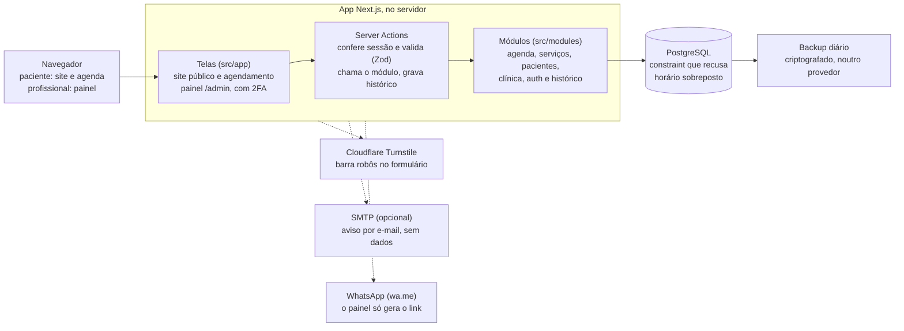
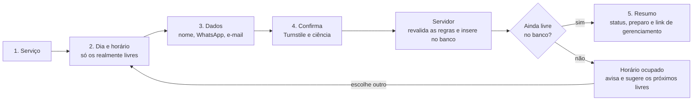
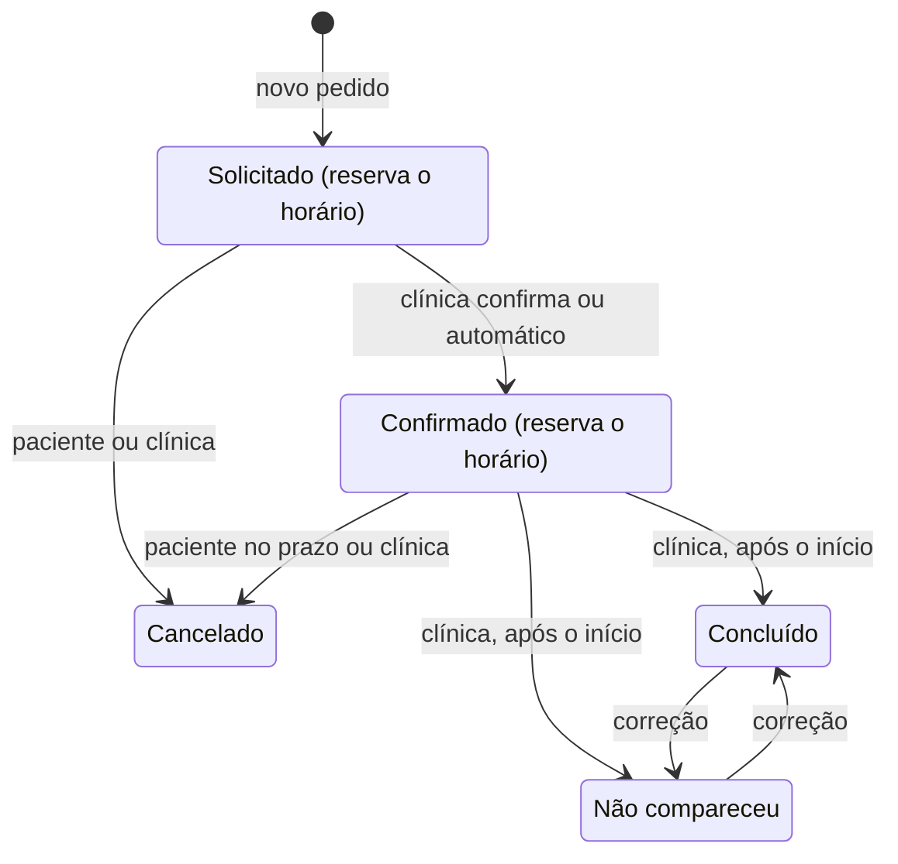

# Planejamento do sistema de agendamentos (Etapa 1)

Aprovado por Guilherme em 29/10/2026. Este arquivo registra as decisões da Etapa 1; mudanças posteriores devem ser documentadas aqui ou em um novo arquivo em `docs/`.

## Resumo das decisões

Um único aplicativo em TypeScript (Next.js) com PostgreSQL entrega site, agendamento e painel num só código e numa só implantação. A peça central é o próprio banco recusar dois agendamentos no mesmo horário.

| Tema                 | Recomendação                                                       | Motivo                                                                                              |
| -------------------- | ------------------------------------------------------------------ | --------------------------------------------------------------------------------------------------- |
| Aplicação            | Next.js com TypeScript, em um projeto só (monólito modular)        | Um código e um deploy; site bem indexado no Google; a mesma validação no navegador e no servidor    |
| Banco de dados       | PostgreSQL com Drizzle ORM e migrações SQL versionadas             | Uma constraint de exclusão impede horários sobrepostos no próprio banco                             |
| Login do painel      | Better Auth, com 2FA e sem cadastro público                        | É a biblioteca que a equipe que hoje mantém o Auth.js indica para projetos novos                    |
| Interface            | Tailwind CSS, shadcn/ui e FullCalendar no painel                   | Componentes acessíveis; visões de dia, semana e mês prontas                                         |
| Confirmação          | Definida por serviço; o padrão é a clínica confirmar               | Procedimentos como PEIM podem exigir avaliação prévia                                               |
| Dados do paciente    | Nome, WhatsApp e e-mail opcional, sem campo de texto livre         | Coleta mínima e nenhum dado de saúde no formulário público                                          |
| Cancelar e reagendar | Link secreto enviado ao paciente, sem login                        | Menos atrito e menos dados pessoais guardados                                                       |
| Hospedagem           | Vercel Pro e Neon, ambos em São Paulo; alternativa: VPS no Brasil  | Menos manutenção para um desenvolvedor sozinho; o código continua portátil                          |

## Análise dos requisitos e escopo do MVP

Os requisitos são coerentes e cabem num MVP, desde que integrações externas, pagamentos e qualquer dado clínico fiquem para etapas seguintes.

| Área           | Entra no MVP                                                                                                                                                           | Fica para depois                                                                       |
| -------------- | ---------------------------------------------------------------------------------------------------------------------------------------------------------------------- | -------------------------------------------------------------------------------------- |
| Site público   | Apresentação da clínica e da profissional, serviços por categoria, contato, link do mapa, botão de WhatsApp, botão Agendar, aviso de privacidade, SEO básico           | Blog, galeria, depoimentos                                                             |
| Agendamento    | Fluxo em cinco passos, regras configuráveis, link para cancelar ou reagendar, arquivo para adicionar ao calendário (.ics)                                                | Lembretes automáticos, lista de espera, sinal e pagamento online, recorrência          |
| Painel         | Agenda por dia, semana e mês; pendências; confirmar, cancelar, reagendar e concluir; serviços; expediente e bloqueios; pacientes; busca; indicadores; conteúdo do site | Relatórios gerenciais, financeiro, vários profissionais e salas, Google Calendar e Outlook |
| Dados de saúde | Nenhum                                                                                                                                                                 | Prontuário, em etapa própria                                                           |

Itens que o pedido não cita e que foram incluídos, porque sem eles a agenda não fica confiável:

- **Agendamento manual pelo painel.** Pedidos que chegam por WhatsApp ou telefone precisam entrar na mesma agenda; senão o sistema não consegue evitar conflitos.
- **Pausar o agendamento online** com um botão, para férias ou imprevistos.
- **Aviso de nova solicitação** para a clínica, sem dados do paciente no conteúdo.
- **Histórico de cada agendamento:** quem mudou o quê e quando.
- **Exportar e anonimizar** os dados de um paciente, para atender pedidos de titulares sem depender de desenvolvedor.

Interpretações adotadas:

- "Intervalos" são tempos de preparo antes e de limpeza depois de cada serviço. Eles bloqueiam a agenda, mas o paciente não os vê.
- "Disponibilidade de cada serviço" são janelas semanais opcionais, como "ozonioterapia só às terças de manhã", sempre dentro do expediente.
- A profissional atende um paciente por vez, então dois agendamentos ativos nunca se sobrepõem.
- Uma solicitação ainda não confirmada já reserva o horário, para dois pacientes não pedirem o mesmo.

## Informações faltantes

Cada item tem um padrão proposto e pode ser ajustado no painel até a publicação.

| #   | Pergunta                                                                                                    | Padrão proposto                                                         | Necessário para |
| --- | ----------------------------------------------------------------------------------------------------------- | ----------------------------------------------------------------------- | --------------- |
| 1   | Quem usa o painel: só ela ou também uma secretária?                                                         | Só ela; o modelo já prevê papéis                                        | Etapa 2         |
| 2   | Algum procedimento permite atender dois pacientes ao mesmo tempo?                                           | Não, um atendimento por vez                                             | Etapa 3         |
| 3   | Quais serviços confirmam sozinhos e quais dependem da clínica?                                              | Todos dependem da clínica até ela mudar                                 | Etapa 3         |
| 4   | Antecedência mínima, limite de dias à frente, prazo para cancelar online e intervalo entre os horários       | 2 horas, 60 dias, 24 horas e 30 minutos                                 | Etapa 3         |
| 5   | Bastam nome, WhatsApp e e-mail opcional? CPF ou data de nascimento são exigidos?                            | Só os três primeiros                                                    | Etapa 3         |
| 6   | A clínica atende menores de idade?                                                                          | Agendamento online só para maiores; menores pelo WhatsApp, com o responsável | Etapa 3    |
| 7   | Existe e-mail profissional e domínio? A clínica quer e-mails automáticos?                                   | E-mail opcional por SMTP; WhatsApp manual como canal principal          | Etapa 3         |
| 8   | Em qual município fica a clínica, e ela abre em feriados?                                                   | Feriados nacionais carregados como bloqueio, editáveis                  | Etapa 3         |
| 9   | Quais exames não sanguíneos serão oferecidos? As habilitações para ozonioterapia e PEIM estão confirmadas?   | O serviço só aparece no site quando ela o ativa                         | Publicação      |
| 10  | Expediente, duração e preço de cada serviço, textos, fotos, logotipo, cores, registro profissional, endereço e contatos | Nenhum dado inventado; campos vazios até ela preencher      | Publicação      |
| 11  | Qual o orçamento mensal de hospedagem?                                                                      | Vercel Pro e Neon em São Paulo                                          | Publicação      |
| 12  | A clínica é pessoa jurídica? Há assessoria jurídica para LGPD?                                              | Ver Privacidade e LGPD                                                  | Publicação      |

## Stack

| Camada                  | Escolha                                                                  | Por quê                                                                                         |
| ----------------------- | ------------------------------------------------------------------------ | ----------------------------------------------------------------------------------------------- |
| Linguagem               | TypeScript em modo estrito, Node.js LTS                                  | Erros aparecem antes de rodar; a mesma linguagem no navegador e no servidor                     |
| Framework               | Next.js (App Router) com Server Actions                                  | Site renderizado no servidor, bom para o Google, e telas interativas e back-end no mesmo projeto |
| Banco                   | PostgreSQL 17 ou superior                                                | Relacional e maduro; constraint de exclusão com faixas de horário impede sobreposição no banco  |
| ORM e migrações         | Drizzle ORM e drizzle-kit                                                | Consultas tipadas e próximas do SQL; migrações em arquivos SQL revisáveis no Git                |
| Autenticação            | Better Auth: e-mail e senha, sessões no banco, 2FA, limite de tentativas | Mantido pela equipe que também mantém o Auth.js e indicado por ela para projetos novos          |
| Validação e formulários | Zod e React Hook Form                                                    | O mesmo esquema valida no navegador e no servidor; o servidor sempre revalida                   |
| Interface               | Tailwind CSS e shadcn/ui                                                 | Componentes acessíveis copiados para o projeto; tema por variáveis, sem kit fechado             |
| Calendário do painel    | FullCalendar, com os plugins gratuitos de dia, semana, mês e lista       | Visões prontas e testadas; arrastar para reagendar                                              |
| Datas                   | date-fns com @date-fns/tz, fuso America/Sao_Paulo                        | Horários gravados em UTC e exibidos no fuso da clínica, à prova de horário de verão             |
| E-mail (opcional)       | Nodemailer via SMTP                                                      | Funciona com qualquer provedor; sem configuração, o sistema segue sem e-mail                    |
| Antirrobô               | Cloudflare Turnstile e limite de requisições no próprio PostgreSQL       | Barra automação sem precisar de Redis                                                           |
| Testes                  | Vitest (unidade e integração com PostgreSQL real) e Playwright           | Cobrem regras de agenda, concorrência e fluxos completos                                        |
| Qualidade               | pnpm, ESLint, Prettier, GitHub Actions e Dependabot                      | Padronização, verificação a cada PR e atualizações de segurança                                 |
| Ambiente local          | Docker Compose com PostgreSQL                                            | O banco de desenvolvimento sobe com um comando                                                  |

### Hospedagem

| Opção                                                                                         | A favor                                                                     | Contra                                                                                                                            |
| --------------------------------------------------------------------------------------------- | --------------------------------------------------------------------------- | --------------------------------------------------------------------------------------------------------------------------------- |
| A (recomendada): Vercel Pro com funções em São Paulo (gru1) e Neon em São Paulo (aws-sa-east-1) | Sem servidor para manter; HTTPS, deploy e prévias automáticos; banco gerenciado com restauração | Custo em dólar: US$ 20 por desenvolvedor por mês na Vercel, mais o plano do banco. O plano gratuito da Vercel é só para uso pessoal e não comercial |
| B: VPS no Brasil com Docker Compose (app, PostgreSQL e proxy HTTPS)                            | Custo fixo menor; controle total                                            | Manutenção do sistema operacional, backups, monitoramento e segurança do servidor ficam por nossa conta                           |

Nas duas opções o código fica portátil: Dockerfile, PostgreSQL padrão e nenhum armazenamento proprietário.

### Alternativas consideradas

- **Laravel com Filament (PHP).** Ótimo para painéis e hospedagem barata. Perde no fluxo interativo do agendamento e não compartilha validação entre navegador e servidor.
- **SPA com API separada.** Dois projetos, dois deploys e autenticação entre eles: complexidade sem ganho para o MVP.
- **Prisma no lugar do Drizzle.** Boa experiência, mas a constraint e as faixas de horário exigiriam SQL manual de qualquer forma.
- **Supabase ou Firebase como back-end completo.** Aceleram o início, mas espalham regras entre banco, políticas de acesso e navegador.

**Ponto de atenção:** desde julho de 2026 o Next.js tem um calendário de releases de segurança, em geral mensal, e em 2025 teve falhas críticas como a CVE-2025-66478 (nota 10.0). Manter o projeto exige atualizar o framework todo mês; o Dependabot abre os PRs e os testes dizem se é seguro aplicar.

## Arquitetura

Um monólito modular: um único app Next.js, com as regras de negócio separadas por domínio em `src/modules` e o banco acessado só pelo servidor.



- **Telas não têm regra de negócio.** As rotas em `src/app` montam a interface e chamam funções dos módulos.
- **Toda escrita segue a mesma ordem:** conferir sessão e permissão, validar com Zod, executar no módulo dentro de uma transação e registrar no histórico.
- **O cálculo de horários livres é uma função pura,** sem acesso ao banco, testada isoladamente com muitos casos de borda.
- **Segurança não depende do proxy** (o antigo middleware). A sessão é conferida no layout do painel e de novo em cada ação e consulta.
- **Sem camadas genéricas:** nada de repositórios abstratos, injeção de dependência, microsserviços ou filas no MVP.
- **Convenção de idioma:** código e banco em inglês; interface, URLs públicas e documentação em português.

## Principais fluxos

Em todos os fluxos o servidor revalida as regras, e o banco tem a palavra final sobre conflito de horário.

### Agendamento pelo paciente



- A escolha de horário mostra só dias e horários realmente livres, calculados na hora, sem expor nada de outros pacientes.
- O formulário pede nome, WhatsApp, e-mail opcional e a ciência do aviso de privacidade. Turnstile e um campo isca barram robôs.
- Ao confirmar, o servidor revalida tudo numa transação: antecedência, expediente, bloqueios e limite de agendamentos por telefone.
- O resumo final mostra status, data, hora, endereço, orientações de preparo, o link de gerenciamento e o botão para adicionar ao calendário.
- Estados previstos: carregando, sem horários no período (com atalho para o WhatsApp), agendamento online pausado e erro de validação no próprio campo.

### Confirmação pela clínica

- Novas solicitações aparecem em destaque na tela inicial do painel. Com e-mail configurado, a clínica também recebe um aviso sem dados do paciente.
- Confirmar ou recusar leva um clique. Recusar registra um cancelamento pela clínica, com motivo interno.
- O botão "Avisar pelo WhatsApp" abre o WhatsApp da profissional com a mensagem pronta (link wa.me), sem API paga.

### Cancelamento e reagendamento

- O paciente usa o link até o prazo configurado, por exemplo 24 horas antes. Depois disso, a página orienta o contato pelo WhatsApp.
- Reagendar reaproveita a escolha de horários. Se o serviço exige confirmação, o pedido volta para Solicitado.
- A clínica cancela ou reagenda a qualquer momento, inclusive arrastando no calendário, e o servidor aplica as mesmas checagens.

### Configuração da agenda

- Expediente semanal com vários intervalos por dia, como 8h às 12h e 13h30 às 18h.
- Janelas opcionais por serviço, sempre dentro do expediente.
- Bloqueios de dia inteiro ou de algumas horas: folga, férias, feriado ou compromisso. Se um bloqueio cobre agendamentos existentes, o painel lista os afetados para ela decidir.
- Feriados nacionais do ano entram com um clique; feriados municipais são cadastrados à mão.
- O agendamento manual pelo painel pode ignorar a antecedência mínima, mas nunca a regra de sobreposição.

### Status do agendamento



Concluído e Não compareceu só podem ser marcados depois do horário de início. A clínica pode trocar um pelo outro se marcar errado, e toda mudança fica no histórico.

## Modelo inicial do banco de dados

Onze tabelas próprias e as tabelas do Better Auth cobrem o MVP. A garantia contra conflito é uma constraint de exclusão sobre o intervalo ocupado de cada agendamento ativo.

| Tabela                 | Para quê                                                | Campos principais                                                                                                                                                                                       |
| ---------------------- | ------------------------------------------------------- | ------------------------------------------------------------------------------------------------------------------------------------------------------------------------------------------------------- |
| clinic_settings        | Dados do site e regras gerais (uma linha só)            | nome, textos, contatos, endereço, fuso, tema, antecedência mínima, limite de dias, passo dos horários, prazo de cancelamento, limite por telefone, agendamento online ligado                           |
| service_categories     | Categorias de serviço                                   | nome, slug, ordem, ativa                                                                                                                                                                                |
| services               | Procedimentos                                           | categoria, nome, slug, descrição, duração, preparo antes, intervalo depois, preço e forma de exibir, exige confirmação, aceita agendamento online, orientações de preparo, ativo, ordem                |
| service_availability   | Janelas opcionais por serviço                           | serviço, dia da semana, início, fim                                                                                                                                                                     |
| business_hours         | Expediente semanal                                      | dia da semana, início, fim (vários por dia)                                                                                                                                                             |
| time_blocks            | Folgas, férias, feriados e bloqueios                    | início, fim, dia inteiro, tipo, título interno                                                                                                                                                          |
| patients               | Dados mínimos do paciente                               | nome, telefone no formato internacional, e-mail opcional, data de anonimização                                                                                                                          |
| appointments           | Agendamentos                                            | paciente, serviço, início, fim, ocupado de e até (com preparo e intervalo), status, origem, cópia do nome e da duração do serviço, cancelado por, motivo, hash do token de gerenciamento, chave de idempotência |
| audit_logs             | Histórico de ações                                      | autor (admin, paciente ou sistema), ação, entidade, mudanças sem dados pessoais, data                                                                                                                   |
| media                  | Logotipo e fotos do site                                | tipo, conteúdo, dimensões                                                                                                                                                                               |
| rate_limits            | Limite de requisições do formulário público             | chave, janela, contagem                                                                                                                                                                                 |
| Tabelas do Better Auth | Usuários do painel, sessões, contas, verificação e 2FA  | papel do usuário (admin no MVP)                                                                                                                                                                         |

A proteção contra conflito fica no próprio banco:

```sql
ALTER TABLE appointments
  ADD CONSTRAINT appointments_no_overlap
  EXCLUDE USING gist (
    tstzrange(occupied_from, occupied_until, '[)') WITH &&
  )
  WHERE (status IN ('requested', 'confirmed'));
```

- O intervalo `[)` permite que um atendimento comece exatamente quando o anterior termina.
- Se duas reservas disputam o mesmo horário, o PostgreSQL grava a primeira e recusa a segunda (erro 23P01). A tela então oferece outros horários.
- Reservar, reagendar e criar bloqueio também usam um lock transacional (`pg_advisory_xact_lock`). Assim, um bloqueio criado no mesmo instante de uma reserva não passa despercebido.
- A chave de idempotência evita agendamento duplicado por clique duplo ou conexão instável.

Outras decisões do modelo:

- Horários gravados em UTC (`timestamptz`); expediente e janelas em hora local, interpretados no fuso da clínica.
- Identificadores UUID, nunca sequenciais, para não serem adivinháveis.
- Serviços com histórico nunca são apagados, só desativados. O agendamento guarda uma cópia do nome e da duração.
- O paciente é identificado por telefone e nome. O mesmo telefone com outro nome, comum entre familiares, gera outro cadastro.
- As imagens do site ficam no próprio banco no MVP: são poucas, entram no backup e têm os metadados removidos, já que o EXIF pode conter localização.

## Segurança

| Risco ou necessidade      | Medida                                                                                                                                                                  |
| ------------------------- | ----------------------------------------------------------------------------------------------------------------------------------------------------------------------- |
| Acesso indevido ao painel | Sem cadastro público: contas criadas por script. Senha com hash forte, 2FA obrigatório por aplicativo autenticador, limite de tentativas, sessões com expiração e revogação |
| Rota protegida contornada | Sessão conferida no layout do painel e em cada ação e consulta, não só no proxy (lição da CVE-2025-29927, que permitia pular o middleware)                             |
| SQL injection             | Consultas parametrizadas do Drizzle; SQL manual só pelo template parametrizado                                                                                          |
| XSS                       | O React escapa o conteúdo por padrão; textos editados no painel nunca viram HTML cru; cabeçalhos CSP, HSTS e bloqueio de iframe                                         |
| CSRF                      | Server Actions só aceitam POST e conferem a origem; o Better Auth valida origens confiáveis; cookies httpOnly, Secure e SameSite                                        |
| Abuso do formulário       | Turnstile, campo isca, limite por IP e por telefone, máximo de agendamentos ativos por telefone, pausa do agendamento online e cancelamento em lote                     |
| Dados inválidos           | Zod em toda entrada no servidor, telefone normalizado e limites de tamanho                                                                                              |
| Segredos                  | Só em variáveis de ambiente validadas na inicialização; `.env` fora do Git; `.env.example` documentado                                                                   |
| Dependências vulneráveis  | Lockfile, Dependabot e atualização mensal junto das releases de segurança do Next.js                                                                                    |
| Excesso de privilégio     | Usuário do banco da aplicação sem superusuário; acesso à produção restrito; desenvolvimento nunca usa cópia de dados reais                                              |
| Vazamento por logs        | Logs só com IDs, nunca nome, telefone, e-mail ou token                                                                                                                  |
| Perda de dados            | Restauração pontual do provedor e dump diário criptografado em outro provedor, guardado por 30 dias; teste de restauração a cada três meses                             |

Meta de recuperação proposta: no pior caso, perder até 24 horas de dados e voltar ao ar em até 4 horas.

## Privacidade e LGPD

O sistema aplica privacidade desde a concepção, mas isso sozinho não o torna adequado à LGPD. Base legal, aviso de privacidade, retenção e contratos com fornecedores precisam de validação jurídica.

### O que o sistema faz

- Coleta mínima: nome, WhatsApp e e-mail opcional. Sem CPF, data de nascimento ou campo de texto livre, que costuma atrair relatos de saúde.
- Trata o vínculo entre paciente e procedimento como possivelmente sensível. Numa clínica, ele pode revelar dado referente à saúde (art. 5º, II), então recebe a mesma proteção.
- Mantém dados de pacientes fora de URLs, logs, avisos à clínica e páginas públicas. O link do paciente usa um token opaco, e a busca por nome no painel não vai para a URL.
- Pede ciência do aviso de privacidade no formulário. Ciência não é consentimento; a base legal será definida com a assessoria.
- Não usa cookies de rastreamento, pixels de anúncio ou analytics de terceiros. O mapa é um link, não um iframe do Google.
- Atende os direitos do titular (art. 18) pelo painel, com exportação e anonimização de dados e um canal de contato publicado.
- Registra quem alterou cada agendamento e aplica a retenção por rotina automática.

### Retenção proposta (a validar)

| Dado                                 | Prazo sugerido                                  | Depois do prazo    |
| ------------------------------------ | ----------------------------------------------- | ------------------ |
| Solicitações canceladas ou recusadas | 6 meses                                         | Anonimizar         |
| Paciente sem novos agendamentos      | 5 anos após o último                            | Anonimizar         |
| Histórico de ações do painel         | 5 anos                                          | Apagar             |
| Logs técnicos                        | 30 dias                                         | Apagar             |
| Backups                              | 30 dias                                         | Rotação automática |
| Registro de incidentes               | 5 anos, o mínimo da Resolução CD/ANPD nº 15/2024 | Apagar             |

### O que precisa de validação fora do código

- [ ] Identificar o controlador (CNPJ ou pessoa física) e publicar o canal do titular.
- [ ] Verificar se a clínica é agente de pequeno porte (Resolução CD/ANPD nº 2/2022), avaliando se o tratamento seria de alto risco. Se for pequeno porte, o encarregado é dispensado, mas o canal de comunicação continua obrigatório.
- [ ] Definir as bases legais com assessoria. Hipótese: procedimentos preliminares a contrato para o agendamento (art. 7º, V) e tutela da saúde para dados de saúde (art. 11, II, f).
- [ ] Redigir o aviso de privacidade: finalidades, dados, fornecedores, retenção, direitos e contato.
- [ ] Revisar os contratos dos fornecedores e a transferência internacional (art. 33). Desde 23/08/2025, cláusulas contratuais só valem se forem as cláusulas-padrão da ANPD (Resolução CD/ANPD nº 19/2024) ou outras aprovadas por ela.
- [ ] Manter o registro das operações de tratamento (art. 37), simplificado se for pequeno porte.
- [ ] Ter um plano de resposta a incidentes: comunicar ANPD e titulares em 3 dias úteis quando houver risco ou dano relevante, com prazo em dobro para pequeno porte.
- [ ] Definir regras para menores de idade, se atendidos: dados de crianças exigem consentimento específico de um dos pais ou responsável (art. 14).
- [ ] Revisar os textos do site com as normas de publicidade do conselho profissional (CFBM e CRBM).
- [ ] Aprovar a política de retenção acima.

## Riscos e mitigação

O maior risco não é técnico: é a agenda online ficar desatualizada porque pedidos chegam por WhatsApp e não entram no painel.

| Risco                                                            | Tipo        | Impacto | Mitigação                                                                                                   |
| ---------------------------------------------------------------- | ----------- | ------- | ----------------------------------------------------------------------------------------------------------- |
| Duas reservas simultâneas no mesmo horário                       | Técnico     | Alto    | Constraint de exclusão, lock transacional e teste automatizado de concorrência                              |
| Erro de fuso ou de horário de verão, que pode voltar a ser adotado | Técnico   | Alto    | UTC no banco, fuso por nome (America/Sao_Paulo) e testes com datas de transição                             |
| Falha no cálculo de horários livres                              | Técnico     | Alto    | Função pura com bateria de testes de bordas, intervalos e bloqueios                                         |
| Falha de segurança no framework                                  | Técnico     | Alto    | Atualização mensal, Dependabot, autorização junto aos dados e firewall da hospedagem                        |
| Horários desatualizados por cache                                | Técnico     | Médio   | Disponibilidade sempre calculada na hora, sem cache                                                         |
| Dependência de um fornecedor                                     | Técnico     | Médio   | PostgreSQL padrão, Dockerfile e nenhum recurso proprietário                                                 |
| Pedidos por WhatsApp ou telefone fora do sistema                 | Operacional | Alto    | Agendamento manual rápido no painel, treinamento e pausa do online                                          |
| Backup que não restaura                                          | Operacional | Alto    | Teste de restauração a cada três meses, com roteiro documentado                                             |
| Solicitações esquecidas segurando horários                       | Operacional | Médio   | Destaque no painel e aviso por e-mail; expiração automática numa etapa futura                               |
| Robôs ou trotes ocupando a agenda                                | Operacional | Médio   | Turnstile, limites por IP e telefone, cancelamento em lote e pausa                                          |
| Perda de acesso ao painel (senha ou 2FA)                         | Operacional | Médio   | Códigos de recuperação, script de redefinição e um segundo administrador                                    |
| Domínio e hospedagem em contas pessoais                          | Operacional | Médio   | Contas em nome da clínica, com 2FA e senhas num gerenciador                                                 |
| Manutenção dependente de uma só pessoa                           | Operacional | Médio   | README, testes, stack popular e tarefas do dia a dia feitas no painel                                       |
| Vazamento de dados que revelam procedimentos                     | Privacidade | Alto    | 2FA, acesso mínimo, criptografia em trânsito e em repouso, logs sem dados pessoais e backups criptografados |
| Coleta excessiva ou relato de saúde no formulário                | Privacidade | Médio   | Formulário mínimo, sem campo livre                                                                          |
| Rastreadores de terceiros no site                                | Privacidade | Médio   | Sem pixels, analytics de anúncios ou iframes de mapa                                                        |
| Transferência internacional sem respaldo contratual              | Privacidade | Médio   | Regiões no Brasil e cláusulas-padrão da ANPD nos contratos                                                  |
| Dados reais usados em desenvolvimento                            | Privacidade | Médio   | Proibido; dados de exemplo marcados como fictícios                                                          |
| Conteúdo do site em desacordo com o conselho profissional        | Regulatório | Médio   | Revisão da profissional antes de publicar                                                                   |

## Preparação para expansões futuras

Nada do futuro entra agora; o modelo só evita decisões que bloqueariam essas extensões.

| Funcionalidade                         | Como entra depois                                                                                                                                                         |
| -------------------------------------- | ------------------------------------------------------------------------------------------------------------------------------------------------------------------------- |
| Lembretes e confirmações por WhatsApp  | API oficial do WhatsApp Business, uma fila de notificações e uma tarefa agendada, com opt-in do paciente. Status e link de gerenciamento já existem                        |
| Google Calendar ou Outlook             | Primeiro um feed .ics privado só com horários, sem nomes; depois sincronização pela API                                                                                   |
| Mais profissionais e salas             | Tabelas de profissionais e salas; a coluna do profissional entra em agendamentos, expediente, bloqueios e na constraint, com a extensão btree_gist. O usuário já tem papel |
| Recorrência e pacotes de sessões       | Uma série liga vários agendamentos comuns, então a constraint continua valendo                                                                                            |
| Lista de espera                        | Interessados por serviço e período, avisados quando um horário é liberado                                                                                                 |
| Pagamento e sinal                      | Tabela de pagamentos e um status de reserva com prazo para pagar, via provedor com Pix                                                                                    |
| Histórico e relatórios                 | Agendamentos e histórico de ações já guardam os dados; relatórios são consultas sobre eles                                                                                |
| Gestão financeira                      | Módulo próprio, ligado aos pagamentos                                                                                                                                     |
| Prontuário eletrônico                  | Etapa própria, com permissões separadas, criptografia de campos, registro de acessos, retenção específica e validação jurídica e regulatória antes de começar              |
| Novos serviços e modalidades           | Cadastro pelo painel; atendimento online seria um campo novo no serviço                                                                                                   |

## Fontes

Páginas consultadas em 29/10/2026.

- [Auth.js passa a ser mantido pela equipe do Better Auth (22/09/2025)](https://www.better-auth.com/blog/authjs-joins-better-auth)
- [Better Auth entra na Vercel e segue código aberto (07/07/2026)](https://better-auth.com/blog/better-auth-joins-vercel)
- [Next.js 16: proxy.ts no lugar de middleware.ts, Node.js 20.9 ou superior](https://nextjs.org/blog/next-16)
- [Blog do Next.js: versão 16.4 e releases de segurança](https://nextjs.org/blog)
- [Programa de releases de segurança do Next.js (13/07/2026)](https://nextjs.org/blog/next-security-release-program)
- [CVE-2025-66478, falha crítica com nota 10.0](https://nextjs.org/blog/CVE-2025-66478)
- [CVE-2025-29927, desvio de autorização no middleware (Fastly)](https://fastly.com/blog/cve-2025-29927-authorization-bypass-in-next-js)
- [PostgreSQL: btree_gist e constraints de exclusão](https://www.postgresql.org/docs/18/btree-gist.html)
- [Regiões do Neon, incluindo São Paulo](https://neon.com/docs/introduction/regions)
- [Regiões da Vercel, incluindo gru1 em São Paulo](https://vercel.com/docs/regions)
- [Plano Hobby da Vercel: só uso pessoal e não comercial](https://vercel.com/docs/plans/hobby-plan)
- [Resolução CD/ANPD nº 15/2024, comunicação de incidentes (Cescon Barrieu)](https://cesconbarrieu.com.br/anpd-aprova-o-regulamento-de-comunicacao-de-incidente-de-seguranca/)
- [Resolução CD/ANPD nº 2/2022, agentes de pequeno porte (Felsberg)](https://www.felsberg.com.br/no-dia-internacional-da-protecao-de-dados-anpd-publica-nova-resolucao-que-regulamenta-a-aplicacao-da-lgpd-para-agentes-de-tratamento-de-pequeno-porte/)
- [Resolução CD/ANPD nº 19/2024, transferência internacional (Lefosse)](https://lefosse.com/noticias/alerta/transferencia-internacional-de-dados-prazo-para-adocao-das-clausulas-padrao-da-anpd-se-encerra-em-23-de-agosto/)
