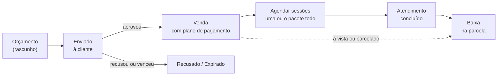

# Módulo financeiro: orçamento, pacotes e baixa de pagamento

Desenho aprovado por Guilherme em 04/11/2026. Complementa o [planejamento da Etapa 1](../../planejamento-etapa-1.md), que já previa o financeiro como "módulo próprio, ligado aos pagamentos" e os pacotes como "uma série que liga vários agendamentos comuns".

## Intenção

A dona da clínica precisa acompanhar o dinheiro de cada cliente, do orçamento até o último pagamento, no mesmo lugar onde fica a agenda. O fluxo pedido é:

> Cliente vem → a dona gera um orçamento → se a cliente aprovar, agenda (uma sessão ou o pacote inteiro de uma vez) → atende → dá baixa no pagamento.

Hoje esse controle fica fora do sistema, e o planejamento já previa que ele entraria depois. O objetivo é que a dona responda sem planilha: quanto essa cliente ainda deve, quantas sessões do pacote faltam, quanto entrou hoje e no mês, e quanto saiu.

## Contexto que este desenho assume

O código do sistema não está neste repositório: ele está em outro computador, "quase pronto". Desde o planejamento da Etapa 1 o escopo mudou, mas a mudança não foi documentada. Este desenho parte do escopo novo:

- **Várias clínicas**, cada uma com marca, link e QR code próprios. Todo dado do financeiro pertence a uma clínica (`clinic_id`).
- **Três níveis de acesso:** cliente (user), dona da clínica (admin) e Guilherme (root).
- Existem tabelas de pacientes, serviços e agendamentos parecidas com as do planejamento, e uma função que calcula os horários livres.

Quem for construir deve, antes de tudo, comparar este desenho com o código real e ajustar os nomes e as ligações. As regras descritas aqui continuam valendo.

## Objetivos

1. **Orçamento feito pela dona,** com um ou mais serviços, quantidade de sessões, preço e desconto.
2. **Aprovação** do orçamento, que o transforma numa venda com plano de pagamento.
3. **Três modos de pagamento no mesmo modelo:** à vista, parcelado e por sessão.
4. **Agendar o pacote de uma vez,** com repetição semanal, mensal ou datas escolhidas à mão.
5. **Dar baixa:** registrar um pagamento com data, valor e forma de pagamento.
6. **Despesas simples:** lançar saídas por categoria.
7. **Visão do dinheiro:** caixa do dia e do mês, valores a receber, parcelas atrasadas e saldo de cada cliente.

## Fora do escopo (por enquanto)

- **Anamnese e prontuário.** Terão desenho próprio, porque são dado de saúde: criptografia de campos, registro de acessos, retenção própria e validação jurídica antes de começar, como diz o planejamento.
- **Pagamento online** (Pix automático, link de pagamento, maquininha integrada). Toda baixa é registrada à mão.
- Comissão de profissionais, estoque, nota fiscal e emissão de boleto.
- Tela financeira para a cliente. A cliente não vê valores no sistema nesta versão.
- A cliente aprovar o orçamento sozinha, por um link.

## Anti-objetivos

O módulo falha, mesmo funcionando, se:

- **um pagamento sumir ou mudar sem rastro.** Nada financeiro é apagado; correções viram estorno, com autor e motivo;
- **o saldo de uma cliente não bater com os pagamentos.** O saldo sempre é calculado a partir das parcelas e pagamentos, nunca guardado à parte e editado à mão;
- **uma clínica enxergar o dinheiro de outra;**
- **a dona precisar de mais cliques do que no caderno** para o caso mais comum: atendeu, recebeu, deu baixa.

## Caminhos considerados

| Caminho                                             | A favor                                                                                                                 | Contra                                                                                |
| --------------------------------------------------- | ----------------------------------------------------------------------------------------------------------------------- | ------------------------------------------------------------------------------------- |
| **1. Módulo próprio dentro do sistema (escolhido)** | Orçamento, agenda e baixa no mesmo lugar; a sessão do pacote fica ligada à parcela; segue a arquitetura do planejamento | É o que dá mais trabalho                                                              |
| 2. Integrar sistema pronto (Asaas, Conta Azul)      | Menos código                                                                                                            | Mensalidade por clínica, marca de terceiros para a dona, orçamento e agenda separados |
| 3. Só um caixa simples (entradas e saídas)          | Muito rápido                                                                                                            | Perde "quanto falta pagar" e a ligação com o pacote, que são o centro do pedido       |

Guilherme escolheu o caminho 1 em 04/11/2026. Os caminhos 2 e 3 quebram o fluxo orçamento → agenda → baixa ou não cobrem os três modos de pagamento.

## Decisões de Guilherme

- **Quem faz o orçamento é sempre a dona,** porque é ela quem decide o preço. A página pública da clínica não muda.
- **Os três modos de pagamento** (à vista, parcelado e por sessão) estão disponíveis.
- **No pacote, todas as sessões são agendadas de uma vez,** com repetição semanal, mensal ou manual.
- **O financeiro é um módulo próprio** (caminho 1).
- **A venda aprovada pode ser alterada:** acrescentar ou retirar sessões e renegociar as parcelas em aberto, sem cancelar e refazer.

## Decisões tomadas no desenho (podem ser revistas)

- **Um modelo só para os três modos.** Toda venda tem uma lista de parcelas a receber. À vista é uma parcela. Parcelado são N parcelas com vencimento. Por sessão é uma parcela por sessão, que vence no dia do agendamento. Assim, telas e relatórios não precisam de três versões.
- **Despesas simples entram:** data, valor, categoria, forma de pagamento e descrição.
- **Formas de pagamento:** Pix, dinheiro, débito e crédito, configuráveis por clínica.
- **A aprovação é registrada pela dona.** A cliente aprova pessoalmente ou pelo WhatsApp, e a dona marca no painel. Para enviar, o painel gera a mensagem pronta do orçamento num link wa.me, como já é feito com os avisos.
- **Validade padrão do orçamento:** 15 dias, ajustável por orçamento.
- **Dinheiro sempre em centavos** (inteiro), em reais. Na divisão das parcelas, a diferença de arredondamento vai para a primeira.
- **Desconto no total do orçamento** é distribuído entre os itens na proporção do valor de cada um. Dentro do item, o valor é dividido pelas sessões, e a sobra do arredondamento fica na primeira sessão. A soma sempre fecha com o total.
- **Crédito parcelado na maquininha** (por exemplo, 3x no cartão) é um pagamento único na forma "crédito", porque a clínica recebe da operadora. O modo parcelado do sistema é para o parcelamento combinado direto com a cliente. Taxas de cartão não entram no cálculo; a dona pode lançá-las como despesa na categoria "Taxas de cartão".
- **Fuso horário:** é um campo da clínica, com America/Sao_Paulo como padrão. As datas de repetição e de vencimento usam o fuso da clínica.

## Fluxo

### 1. Orçamento

- A dona escolhe a cliente (ou cadastra uma nova) e adiciona os itens. Cada item tem serviço, quantidade de sessões, preço unitário e desconto opcional.
- O preço vem do cadastro do serviço, mas pode ser editado. O item guarda uma cópia do nome e do preço, como o agendamento já faz.
- Há desconto por item e no total, em valor ou em porcentagem, e um campo de observação visível para a cliente.
- **Status:** rascunho → enviado → aprovado, recusado ou expirado. A dona também pode cancelar. Só o rascunho pode ser editado; para mudar um orçamento enviado, ela duplica o orçamento e cancela o antigo.
- A expiração é calculada pela validade. Um orçamento vencido ainda pode ser aprovado se a dona confirmar ("aprovar mesmo assim").

### 2. Aprovação → venda

Ao aprovar, a dona escolhe o plano de pagamento (depois, ele ainda pode ser alterado; ver a seção 6). Isso cria a venda e as parcelas numa única transação.

| Modo       | Parcelas criadas                                                                                                                                   |
| ---------- | -------------------------------------------------------------------------------------------------------------------------------------------------- |
| À vista    | 1 parcela com o total; o vencimento padrão é hoje                                                                                                  |
| Parcelado  | N parcelas; a dona define a quantidade, a data da primeira e o intervalo (mensal por padrão), e pode editar cada valor e cada data antes de salvar |
| Por sessão | 1 parcela por sessão de cada item, com valor igual ao preço da sessão já com desconto, sem vencimento até a sessão ser agendada                    |

- Antes de salvar, a tela mostra o resumo: total, número de parcelas e soma conferida. **A soma das parcelas é sempre igual ao total da venda,** e o servidor recusa o que não bater.
- Um sinal, como "metade agora e o resto depois", é feito com o parcelado: duas parcelas com valores diferentes.
- Depois de aprovada, a venda fica com as sessões "a agendar".

### 3. Agendar as sessões (pacote)

Na venda, cada item mostra quantas sessões foram contratadas, quantas estão agendadas e quantas foram feitas. A dona agenda uma sessão de cada vez ou várias:

- **Semanal:** dia da semana, horário e a cada quantas semanas, começando numa data.
- **Mensal:** o mesmo dia do mês, no mesmo horário. Se o mês não tiver o dia, como 31 em abril, usa o último dia do mês.
- **Manual:** a dona escolhe cada data e horário.

O sistema propõe as datas para as sessões que faltam e confere cada uma com a mesma função de horários livres do agendamento comum: expediente, bloqueios e conflitos. As datas com problema aparecem destacadas, com o motivo e o próximo horário livre, e a dona ajusta uma por uma. **Ao salvar, grava tudo ou nada:** se uma data for ocupada nesse meio-tempo (a constraint do banco recusa), nenhuma é gravada e a tela mostra qual falhou.

- Os agendamentos de pacote são agendamentos comuns, com a mesma constraint contra sobreposição. Eles só ganham a ligação com o item da venda.
- Agendamentos criados pela dona a partir da venda já nascem confirmados.
- No modo por sessão, ao agendar, cada sessão é ligada à próxima parcela livre do item, e o vencimento da parcela passa a ser a data do agendamento.

### 4. Atendimento e sessões

- **Concluído:** a sessão conta como feita.
- **Cancelado:** a sessão volta para "a agendar". No modo por sessão, a parcela é desligada e perde o vencimento. Se a parcela já estava paga, ela continua paga, como crédito da cliente. A próxima sessão agendada usa primeiro as parcelas pagas e sem sessão, e só depois as abertas.
- **Não compareceu:** a dona escolhe entre "devolver a sessão ao pacote" (o padrão) e "contar a sessão". Se contar, a parcela continua valendo.
- Uma venda não pode ter mais sessões agendadas e feitas do que as contratadas.

### 5. Baixa

- **Ponto principal:** ao marcar um atendimento como concluído, se houver parcela ligada em aberto, o painel já oferece "Receber agora", com o valor e a forma de pagamento preenchidos. É o caso mais comum, resolvido em um passo.
- Também dá para dar baixa pela venda, pela ficha da cliente ou pela lista de "a receber".
- **Um pagamento tem** data, valor, forma de pagamento, quem registrou e observação opcional. Uma parcela pode receber vários pagamentos (pagamento parcial). Ela fica paga quando a soma alcança o valor.
- Um pagamento maior que o saldo da parcela não é aceito; para adiantar, a dona paga as próximas parcelas.
- **Estorno, em vez de apagar:** um pagamento registrado por engano é estornado, com motivo. Ele continua no histórico, riscado, e deixa de contar no saldo da parcela.
- **O caixa não reescreve o passado:** o pagamento entra no caixa na data informada pela dona, que pode ser retroativa. O estorno entra como lançamento negativo na data em que foi feito, e o dia original continua como estava. A lista mostra quando um lançamento foi registrado com data passada.

### 6. Alterar uma venda aprovada

Decisão de Guilherme: a venda pode ser alterada depois de aprovada, sem precisar cancelar e refazer. O que já foi pago nunca muda.

- **Acrescentar:** mais sessões de um item ou um item novo, com preço e desconto.
- **Retirar:** sessões ainda não agendadas nem feitas. Sessões agendadas precisam ser canceladas antes.
- **Renegociar o que falta:** a dona refaz as parcelas em aberto, mudando a quantidade, os valores e as datas. As parcelas pagas e as que têm pagamento parcial ficam como estão.
- **No modo por sessão,** acrescentar sessões cria parcelas novas, e retirar cancela as parcelas abertas sem sessão ligada.
- **A soma continua fechando:** depois da alteração, parcelas pagas + parcelas em aberto = novo total. O servidor recusa o que não bater.
- **O total não pode ficar menor que o já pago.** Se a cliente pagou a mais, a diferença é devolvida como despesa "Devolução a cliente" ou deixada como crédito numa parcela paga sem sessão.
- **Toda alteração vira uma revisão da venda,** com autor, data, motivo e o antes e depois dos itens, do total e das parcelas. O detalhe da venda mostra essas revisões em ordem.
- **A venda guarda a ligação com o orçamento original,** que continua congelado como foi enviado.

### 7. Cancelar uma venda

- A dona pode cancelar a venda, com motivo. As parcelas sem pagamento são canceladas, e as sessões futuras ela escolhe entre cancelar ou manter.
- Se houver devolução de dinheiro à cliente, ela é lançada como saída na categoria "Devolução a cliente", ligada à venda. Não há estorno automático.

### 8. Despesas

- Data, valor, categoria, forma de pagamento e descrição.
- Categorias iniciais: aluguel, produtos e materiais, contas, devolução a cliente e outros. A dona pode criar outras.
- Uma despesa lançada errado é cancelada com motivo, não apagada.

## Telas do painel (admin)

| Tela               | Conteúdo                                                                                                                                                                     |
| ------------------ | ---------------------------------------------------------------------------------------------------------------------------------------------------------------------------- |
| Financeiro, início | Entrou hoje e no mês (por forma de pagamento), saiu no mês, saldo do mês, parcelas atrasadas e total a receber, separado em "com vencimento" e "sessões ainda não agendadas" |
| Orçamentos         | Lista com filtro por status; criar, enviar (link wa.me), aprovar, recusar e duplicar                                                                                         |
| Vendas             | Lista com o saldo de cada uma; detalhe com itens, sessões (contratadas, agendadas, feitas), parcelas, pagamentos e "Agendar sessões"                                         |
| A receber          | Parcelas em aberto por vencimento, atrasadas em destaque, com baixa direto da lista                                                                                          |
| Caixa              | Lançamentos do período: pagamentos recebidos e despesas, com totais por forma de pagamento                                                                                   |
| Despesas           | Lista e cadastro                                                                                                                                                             |
| Ficha da cliente   | Ganha uma aba Financeiro: orçamentos, vendas, saldo devedor e sessões restantes                                                                                              |

O root vê as mesmas telas em qualquer clínica e um resumo com o total de cada clínica.

## Modelo de dados

Todas as tabelas têm `id` UUID, `clinic_id` e `created_at`. Os valores são inteiros em centavos.

| Tabela                   | Para quê                               | Campos principais                                                                                                                                                     |
| ------------------------ | -------------------------------------- | --------------------------------------------------------------------------------------------------------------------------------------------------------------------- |
| quotes                   | Orçamentos                             | paciente, número sequencial por clínica (para falar com a cliente), status, válido até, desconto do total, observação, criado por, datas de envio, aprovação e recusa |
| quote_items              | Itens do orçamento                     | orçamento, serviço, cópia do nome, sessões, preço unitário, desconto                                                                                                  |
| sales                    | Venda gerada na aprovação              | orçamento, paciente, modo de pagamento, total, status (ativa, quitada, cancelada), motivo do cancelamento                                                             |
| sale_items               | Itens da venda, com o saldo de sessões | venda, serviço, cópia do nome, sessões contratadas, preço por sessão                                                                                                  |
| installments             | Parcelas a receber                     | venda, número, valor, vencimento (vazio no modo por sessão até agendar), agendamento ligado (opcional), status (aberta, paga, cancelada)                              |
| payments                 | Baixas                                 | parcela, data, valor, forma de pagamento, registrado por, observação, estornado em, estornado por, motivo do estorno                                                  |
| payment_methods          | Formas aceitas pela clínica            | nome, ativa, ordem                                                                                                                                                    |
| expenses                 | Despesas                               | data, valor, categoria, forma de pagamento, descrição, venda ligada (para devolução), cancelada em, motivo                                                            |
| expense_categories       | Categorias de despesa                  | nome, ativa                                                                                                                                                           |
| sale_revisions           | Histórico de alterações da venda       | venda, autor, data, motivo, antes e depois (itens, total, parcelas)                                                                                                   |
| appointment_series       | Regra usada para agendar o pacote      | item da venda, tipo (semanal, mensal, manual), parâmetros da repetição                                                                                                |
| appointments (já existe) | Ganha a ligação com o pacote           | item da venda (opcional), série (opcional)                                                                                                                            |

Regras que o banco garante:

- **Os valores não podem ser negativos;** parcelas e pagamentos devem ser maiores que zero.
- **Cada agendamento fica ligado a no máximo uma parcela** (índice único parcial).
- **A soma das parcelas é igual ao total da venda e os pagamentos ativos não passam do valor da parcela.** Essa regra é conferida na transação, no módulo, e coberta por testes.
- **Status, saldo e "atrasada" são derivados.** O status da parcela é atualizado na mesma transação de cada pagamento ou estorno. "Atrasada" significa vencida e não paga, e é calculada na consulta, nunca guardada.
- Toda escrita financeira gera registro no histórico de ações (`audit_logs`), com autor e valores, sem dados pessoais.
- Toda consulta filtra por `clinic_id` da sessão do usuário, e o root pode escolher a clínica.

## Permissões

| Ação                                          | Cliente | Admin (dona)          | Root  |
| --------------------------------------------- | ------- | --------------------- | ----- |
| Ver e criar orçamentos, vendas e baixas       | Não     | Só da própria clínica | Todas |
| Estornar pagamento, alterar ou cancelar venda | Não     | Sim, com motivo       | Sim   |
| Despesas e caixa                              | Não     | Só da própria clínica | Todas |
| Formas de pagamento e categorias              | Não     | Sim                   | Sim   |

## Testes que precisam existir

- **Divisão em parcelas:** arredondamento e soma igual ao total, para vários totais e quantidades.
- **Pagamento parcial, quitação e estorno:** o status da parcela e da venda acompanha cada operação.
- **Datas da repetição:** semanal a cada N semanas; mensal no dia 29, 30 ou 31; virada de ano; horário de verão (fuso America/Sao_Paulo).
- **Alteração da venda:** acrescentar e retirar sessões, renegociar parcelas com pagamento parcial, recusar total menor que o já pago.
- **Agendamento do pacote:** grava tudo ou nada quando uma data é tomada no meio; não deixa passar do número de sessões contratadas.
- **Por sessão:** ligação e desligamento da parcela ao agendar, cancelar e registrar falta.
- **Isolamento:** um admin não lê nem altera dados de outra clínica, em nenhuma ação.

## O que fica para quem construir

- **Antes de planejar, conferir no código real:** de onde vem o `clinic_id` da sessão, como o root escolhe a clínica, se pacientes, serviços e a constraint contra sobreposição já são separados por clínica (ou por profissional), e como a conta da cliente se liga ao cadastro de paciente. O plano de implementação só deve ser escrito depois disso.

- Encaixar os nomes de tabelas e campos no código real e decidir se `sales` e `quotes` ficam em tabelas separadas ou numa só com status. Separar é o recomendado, porque o orçamento fica congelado como foi enviado.
- O formato da mensagem do orçamento no WhatsApp.
- O layout das telas, seguindo os componentes já usados no painel.
- A ordem de entrega. Sugestão: orçamento e venda à vista; depois parcelado e baixa; por sessão e agendamento em série; despesas e caixa; por fim a tela de início.
